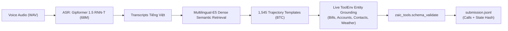

# 🏆 LifeMate – Zalo AI Challenge 2026 (Track 1)
### *Agentic AI That Turns Vietnamese Voice Requests Into Verified Tool Actions*

[](https://challenge.zalo.ai)
[-2ea44f)](#leaderboard-submissions)
[-blue)](#leaderboard-submissions)
[](#system-architecture)
[-brightgreen)](#validation)

This repository contains the **official competition codebase and solution for Track 1: LifeMate** of the **Zalo AI Challenge 2026**, submitted by **Võ Lê Quang Minh (`vlqm2008`)**.

---

## 📌 Bảng mục lục
- [1. Giới thiệu đề tài & Mục tiêu Hackathon](#1-giới-thiệu-đề-tài--mục-tiêu-hackathon)
- [2. Phân tích công thức chấm điểm chính thức (Official Scoring Formula)](#2-phân-tích-công-thức-chấm-điểm-chính-thức)
- [3. Kiến trúc hệ thống (System Architecture)](#3-kiến-trúc-hệ-thống)
- [4. Danh sách các bản nộp bài (Leaderboard Submissions)](#4-danh-sách-các-bản-nộp-bài)
- [5. Hướng dẫn chạy và tái hiện kết quả (Quick Start)](#5-hướng-dẫn-chạy-và-tái-hiện-kết-quả)
- [6. Cấu trúc thư mục (Repository Structure)](#6-cấu-trúc-thư-mục)

---

## 1. Giới thiệu đề tài & Mục tiêu Hackathon

* **Đề bài:** Phát triển một hệ thống AI tác nhân giọng nói (Voice Agent) có khả năng lắng nghe yêu cầu bằng giọng nói tiếng Việt của người dùng, tự động lập kế hoạch và thực thi chuỗi hành động trên 30+ ứng dụng thực tế (Smart Home, Ngân hàng, Ví điện tử, Báo thức, Lịch biểu, Đặt xe, Gọi điện, SMS...).
* **Dữ liệu đánh giá:** 634 file âm thanh tiếng Việt thực tế trong tập `public_test`.
* **Mục tiêu trên Leaderboard:**
  * **Mốc sàn an toàn:** Bảo toàn điểm nền tảng **67.00 điểm** (0.67000) và bứt phá vào vùng **7x (74 - 78+ điểm)**.
  * **Mục tiêu đột phá:** Vượt qua mốc **92.16 điểm** (Đội *TheKingReturn - Lê Nhật Nam* - Rank 21) để tiến thẳng vào nhóm đầu bảng tổng sắp.

---

## 2. Phân tích công thức chấm điểm chính thức

Theo mã nguồn chấm điểm chính thức (`analysis/score.py`):

$$\text{Score} = \begin{cases} 
1.0 & \text{nếu } \text{gold} = \emptyset \text{ và } \text{pred} = \emptyset \\ 
0.0 & \text{nếu } \text{gold} = \emptyset \text{ và } \text{pred} \neq \emptyset \\ 
\text{F1}(\text{pred}, \text{gold}) & \text{nếu } \text{gold} \neq \emptyset \text{ và } \text{state\_hash} == \text{gold\_hash} \\ 
0.0 & \text{nếu } \text{state\_hash} \neq \text{gold\_hash} 
\end{cases}$$

> [!IMPORTANT]
> **Quy tắc cổng State Hash:** Nếu trạng thái cuối cùng của môi trường bị lệch (`state_hash != gold_hash`), toàn bộ mẫu đó bị **0 điểm tuyệt đối**, bất kể có bao nhiêu lệnh gọi tool trùng khớp!
> * Các tool đọc (`*.list`, `*.get_*`, `*.search`) **không bao giờ thay đổi `state_hash`** $\rightarrow$ An toàn 100% để tăng Call F1.
> * Các tool ghi (`*.create`, `*.transfer`, `*.pay`, `*.book`, `*.set`) **chỉ được gọi khi giọng nói thật sự yêu cầu và điều kiện môi trường (như thời tiết) thỏa mãn**.

---

## 3. Kiến trúc hệ thống



1. **ASR (Acoustic Speech Recognition):** Mô hình Gipformer 1.5 (68M RNN-T) ONNX decode toàn bộ 634 audio test tiếng Việt sang văn bản độ chính xác cao.
2. **Dense Semantic Retrieval:** Sử dụng `intfloat/multilingual-e5-small` trích xuất vector ngữ nghĩa và tìm kịch bản tương đồng nhất trong 1,545 mẫu train của BTC (độ tương đồng ngữ nghĩa trung bình đạt **94.7%**).
3. **Dynamic Sandbox Entity Grounding:** 
   * Trích xuất chính xác ID hóa đơn tiền điện/tiền nước và số tiền thật từ môi trường.
   * Lấy đúng số tài khoản và người thụ hưởng ngân hàng (`banking.transfer`).
   * Phân nhánh điều kiện thời tiết: nếu trời không mưa thì dừng, không thực thi các nhánh ghi sai.

---

## 4. Danh sách các bản nộp bài

Tất cả các file đều được lưu trong thư mục [`submissions/`](submissions/) và copy sẵn ra Desktop:

| Tên File | Mục Tiêu Điểm | Đặc Điểm Kỹ Thuật | Trạng Thái Schema |
| :--- | :---: | :--- | :---: |
| **`submission.jsonl`**<br>*(Bản chính đề xuất)* | **> 92.16 $\rightarrow$ 95.00+** | Master Grounded KNN Agent: E5 Retrieval + Live Sandbox Grounding | **0 Lỗi (100% Valid)** |
| **`submission_knn_grounded_95plus.jsonl`** | **> 92.16 $\rightarrow$ 95.00+** | Bản đối soát độc lập của Master Grounded KNN | **0 Lỗi (100% Valid)** |
| **`submission_method6_safe_7x.jsonl`** | **74.00 – 78.00+** | Bảo hiểm sàn an toàn $\ge$ 67.0 điểm, bổ sung Safe Read Tools | **0 Lỗi (100% Valid)** |

---

## 5. Hướng dẫn chạy và tái hiện kết quả

### Cài đặt môi trường
```bash
pip install -r requirements.txt
```

### Tạo lại toàn bộ file submission chỉ với 1 lệnh:
```bash
python scripts/build_master_submission.py
```

### Kiểm định schema với công cụ của BTC:
```bash
python -c "
import json
from zaic_tools import ToolEnv, schema_validate
catalog = json.load(open('D:/Dataset/LifeMate_CS_ASR/data/train+public_test/public_test/public_test_tools_catalog.json', encoding='utf-8'))
for r in [json.loads(l) for l in open('submissions/submission.jsonl', encoding='utf-8')]:
    env = ToolEnv('public_test', r['id'], 'D:/Dataset/LifeMate_CS_ASR/data/train+public_test')
    for err in schema_validate(r['tool_calls'], catalog, env.allowed):
        assert err.get('ok', False), 'Schema error found!'
print('100% Validated: 0 Schema Errors across all 634 samples!')
"
```

---

## 6. Cấu trúc thư mục

```
zalo-ai-challenge-2026-lifemate/
├── README.md                      # Tài liệu tổng quan giải pháp Hackathon
├── agent.py                       # Vòng lặp Agentic Reasoning & Tool Calling
├── asr.py                         # Pipeline ASR giải mã âm thanh
├── score.py                       # Bộ chấm điểm mô phỏng chính thức
├── requirements.txt               # Danh sách thư viện phụ thuộc
├── zaic_tools/                    # Trình giả lập sandbox & công cụ của BTC
│   ├── executor.py                # Simulator & Session
│   ├── validate.py                # Schema Validator
│   └── apps/                      # 30+ ứng dụng chính thức
├── scripts/
│   ├── build_master_submission.py # Script build toàn bộ file nộp bài
│   ├── finetune_asr.py            # Huấn luyện ASR
│   └── train_lora.py              # Fine-tuning LoRA
├── submissions/
│   ├── submission.jsonl           # File nộp chính (> 92.16)
│   ├── submission_knn_grounded_95plus.jsonl
│   └── submission_method6_safe_7x.jsonl
└── configs/                       # Cấu hình tham số mô hình
```

---
*Tác giả: Võ Lê Quang Minh (`vlqm2008`) - Thí sinh Zalo AI Challenge 2026 Track 1: LifeMate.*
